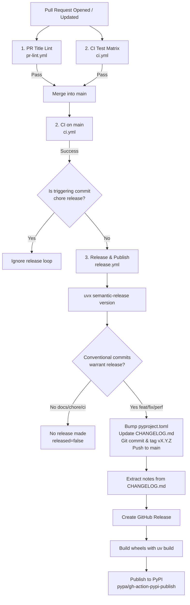

# Contributing to langchain-okf

Thank you for contributing to `langchain-okf`! This guide explains our development workflow, commit message conventions, quality checks, and how the automated CI/CD release pipeline functions.

---

## Table of Contents
1. [Overview & Architecture of the Pipelines](#1-overview--architecture-of-the-pipelines)
2. [Commit Message Conventions (Conventional Commits)](#2-commit-message-conventions-conventional-commits)
   - [Release Impact Matrix](#release-impact-matrix)
   - [Format Specification](#format-specification)
   - [Commit Types Reference](#commit-types-reference)
   - [Breaking Changes](#breaking-changes)
   - [Squash & Merge Best Practices](#squash--merge-best-practices)
3. [Local Development Setup](#3-local-development-setup)
   - [Installing Dependencies](#installing-dependencies)
   - [Running Quality Checks & Tests](#running-quality-checks--tests)
   - [Pre-Flight Release Script](#pre-flight-release-script)
4. [How the GitHub Actions Pipelines Work](#4-how-the-github-actions-pipelines-work)
   - [Pipeline Flowchart](#pipeline-flowchart)
   - [1. PR Linting (`pr-lint.yml`)](#1-pr-linting-pr-lintyml)
   - [2. Continuous Integration (`ci.yml`)](#2-continuous-integration-ciyml)
   - [3. Release & Publish (`release.yml`)](#3-release--publish-releaseyml)
5. [Frequently Asked Questions & Troubleshooting](#5-frequently-asked-questions--troubleshooting)

---

## 1. Overview & Architecture of the Pipelines

`langchain-okf` uses **fully automated continuous delivery** powered by [`python-semantic-release`](https://python-semantic-release.readthedocs.io/), GitHub Actions, and PyPI Trusted Publishing.

- **You never manually edit version numbers** in `pyproject.toml`.
- **You never manually write release tags** or create releases on GitHub.
- **Your commit messages dictate everything**: whether a release is produced, whether it bumps `major`, `minor`, or `patch`, and what content populates `CHANGELOG.md` and the GitHub Release notes.

---

## 2. Commit Message Conventions (Conventional Commits)

Every commit that lands on `main` (and every PR title) must adhere strictly to the **Conventional Commits 1.0.0** specification.

### Release Impact Matrix

| Commit Type | SemVer Impact | Triggers Release? | Example Summary |
| :--- | :--- | :---: | :--- |
| `feat` | **MINOR** (`0.2.0` → `0.3.0`) | **YES** | New user-facing feature, tool, or API |
| `fix` | **PATCH** (`0.2.0` → `0.2.1`) | **YES** | Bug fix or error correction |
| `perf` | **PATCH** (`0.2.0` → `0.2.1`) | **YES** | Performance optimization |
| `feat!` / `fix!` / `BREAKING CHANGE:` | **MAJOR** (`1.0.0` → `2.0.0`)* | **YES** | Incompatible breaking API modification |
| `docs` | None | **NO** | Documentation changes (README, docstrings) |
| `test` | None | **NO** | Adding or refactoring unit/integration tests |
| `refactor` | None | **NO** | Code restructure without feature or bug changes |
| `style` | None | **NO** | Formatting, whitespace, imports (no code change) |
| `chore` | None | **NO** | Maintenance, dependencies, general housekeeping |
| `ci` | None | **NO** | GitHub Actions workflows and CI scripts |
| `build` | None | **NO** | Packaging, build system, external tool configs |

> **Note on `0.x.y` Releases:** Under current repository settings (`major_on_zero = false`), breaking changes on initial alpha/beta development versions (`0.x`) bump the **minor** version instead of jumping to `1.0.0`.

---

### Format Specification

```text
<type>(<optional-scope>): <short imperative description>

[optional body explaining motivation and technical context]

[optional footer(s), e.g. BREAKING CHANGE: ... or Fixes #123]
```

#### Rules to Follow:
1. **Lowercase type**: Must be one of the allowed types (`feat`, `fix`, `perf`, `docs`, `chore`, `ci`, `refactor`, `test`, `build`, `style`).
2. **Imperative mood**: Write `"add retriever filter"` instead of `"added retriever filter"` or `"adds retriever filter"`.
3. **No trailing period**: Keep the header subject line clean (`feat: support chroma` instead of `feat: support chroma.`).
4. **Header length**: Keep the first line under 72 characters when possible.

---

### Commit Types Reference

#### 1. `feat` (Feature → Minor Release)
Use when introducing new functionality accessible to library consumers or agents.
- `feat(retriever): add over-fetching and trust tier post-filtering`
- `feat(bundle): support docling extraction backend for pdf ingestion`
- `feat: add okf_verify_concept langchain agent tool`

#### 2. `fix` (Bug Fix → Patch Release)
Use when correcting an unexpected bug, runtime failure, or regression.
- `fix(graph): resolve cyclic dependency infinite loop in cross-link expansion`
- `fix(retriever): handle missing concept metadata without raising keyerror`
- `fix: prevent race condition in atomic write operation`

#### 3. `perf` (Performance → Patch Release)
Use when code is optimized to run faster or consume fewer resources without altering functionality.
- `perf(bundle): compute sha-256 chunk cache to bypass re-embedding`
- `perf(retriever): vector store cold load optimization via index fingerprinting`

#### 4. `docs` (Documentation → No Release)
Use for modifying README, docstrings, typing comments, or architectural documentation.
- `docs: add memory lifecycle sequence diagram to readme`
- `docs(retriever): clarify max_hops traversal parameter behavior`

#### 5. `test` (Testing → No Release)
Use for writing, updating, or organizing test fixtures and test cases.
- `test(retriever): add test cases for stale policy ttl eviction`
- `test: mock vectorstore embeddings in unit tests`

#### 6. `refactor` (Refactoring → No Release)
Use when reorganizing or cleaning up code structure without fixing bugs or adding features.
- `refactor(generator): separate markdown frontmatter parsing into helper utility`
- `refactor: simplify knowledge graph edge traversal logic`

#### 7. `chore` (Chores & Housekeeping → No Release)
Use for regular repository maintenance, dependency updates, or metadata tasks.
- `chore: update uv.lock dependencies`
- `chore: prune unused packages from optional-dependencies`

#### 8. `ci` (CI/CD Workflows → No Release)
Use when modifying `.github/workflows/`, GitHub actions, or automation scripts.
- `ci(release): attach branch reference during checkout in workflow_run`
- `ci: enable python 3.14 in test matrix`

#### 9. `build` (Build System → No Release)
Use for changes to build targets, hatchling configuration, or packaging configs.
- `build: update wheel targets and include patterns in pyproject.toml`

---

### Breaking Changes

A breaking change alters an existing public API or behavior such that consumers must update their code.

To signal a breaking change:
1. Append an exclamation mark `!` after the type/scope:
   ```text
   feat(retriever)!: change return type of okf_search to structured Pydantic model
   ```
2. Or include `BREAKING CHANGE:` in the commit message footer:
   ```text
   feat(retriever): remove deprecated query_expansion argument

   BREAKING CHANGE: The `query_expansion` argument has been replaced by `expansion_hops`.
   ```

---

### Squash & Merge Best Practices

When you submit a Pull Request, GitHub offers multiple merge strategies.
**If using "Squash and Merge":**
1. The **Pull Request Title** becomes the default commit subject on `main`.
2. Ensure your PR title adheres strictly to the Conventional Commit syntax (e.g. `feat(retriever): add over-fetching`).
3. The PR lint pipeline (`pr-lint.yml`) verifies your PR title automatically before merge.

---

## 3. Local Development Setup

We use [`uv`](https://github.com/astral-sh/uv) as the fast, single-binary package and project manager.

### Installing Dependencies

```bash
# Clone the repository
git clone https://github.com/AyushDey/langchain-okf.git
cd langchain-okf

# Sync virtual environment with all development and vectorstore dependencies
uv sync --dev --extra chroma
```

### Running Quality Checks & Tests

Before committing code or submitting a PR, ensure all linters and tests pass locally:

```bash
# 1. Run Ruff linter
uv run ruff check langchain_okf/ tests/

# 2. Run Ruff format check (or run `uv run ruff format langchain_okf/ tests/` to auto-format)
uv run ruff format --check langchain_okf/ tests/

# 3. Run MyPy type checker
uv run mypy langchain_okf/

# 4. Run Pytest suite
uv run pytest tests/ -v
```

### Pre-Flight Release Script

You can also run our automated verification script that executes all gates sequentially:

```bash
python3 scripts/release_check.py
```

---

## 4. How the GitHub Actions Pipelines Work

### Pipeline Flowchart



---

### 1. PR Linting (`pr-lint.yml`)
- **Trigger**: Every pull request opened, edited, or synchronized.
- **Role**: Uses `amannn/action-semantic-pull-request` to ensure the PR title starts with a valid type (`feat`, `fix`, `perf`, `docs`, `chore`, `ci`, `refactor`, `test`, `build`, `style`).
- **Result**: Protects `main` from receiving unstructured commits that would break changelog generation.

### 2. Continuous Integration (`ci.yml`)
- **Trigger**: Pushes to `main` and Pull Requests targeting `main`.
- **Role**: Runs test matrix across Python `3.10`, `3.11`, `3.12`, and `3.13`.
- **Steps**:
  - `uv run ruff check langchain_okf/ tests/`
  - `uv run ruff format --check langchain_okf/ tests/`
  - `uv run mypy langchain_okf/`
  - `uv run pytest tests/ -v`

### 3. Release & Publish (`release.yml`)
- **Trigger**: Automatically executes upon completion of the `CI` workflow on the `main` branch (via `workflow_run`) or manual trigger (`workflow_dispatch`).
- **Safety Gate**: Runs only if `CI` succeeded and the head commit message does **not** begin with `chore(release):` (preventing recursive triggers).
- **Execution**:
  1. Checks out the `main` branch (`ref: ${{ github.event.workflow_run.head_branch || github.ref_name }}`) with `fetch-depth: 0`.
  2. Runs Python 3.10 test suite and quality gates.
  3. Executes `uvx semantic-release version`:
     - Inspects all commits since the last Git tag (`vX.Y.Z`).
     - Parses commit messages using the rules in `[tool.semantic_release]`.
     - Updates version in `pyproject.toml`.
     - Updates `CHANGELOG.md`.
     - Commits changes with `chore(release): {version} [skip ci]`.
     - Creates tag `v{version}` and pushes to GitHub.
  4. Parses the release notes directly from `CHANGELOG.md` as the single source of truth.
  5. Creates or updates the GitHub Release with the notes.
  6. Executes `uv build` to generate `.whl` and `.tar.gz` packages.
  7. Invokes the `publish` job to push distributions directly to PyPI using trusted publishing credentials.

---

## 5. Frequently Asked Questions & Troubleshooting

### Q: I merged a PR, but no new release was published. Why?
**A:** Check the commit types in your PR. If all commits since the last release are `docs`, `chore`, `ci`, `test`, `refactor`, or `style`, `python-semantic-release` intentionally does not create a release because there are no user-facing changes or bug fixes. To trigger a release, your PR must include at least one `fix` (patch), `perf` (patch), or `feat` (minor).

### Q: Why did the release step fail with "Detached HEAD state cannot match any release groups"?
**A:** `python-semantic-release` matches the active Git branch against `[tool.semantic_release.branches.main]` (`main|master`). If `actions/checkout` checks out a commit SHA instead of the branch name (`head_branch`), Git is in detached HEAD state and has no branch name. Always ensure `ref: ${{ github.event.workflow_run.head_branch || github.ref_name }}` is used.

### Q: Why did git push fail with "! [remote rejected] ... (missing necessary objects)"?
**A:** `actions/checkout@v4` defaults to `--no-tags` (`fetch-tags: false`), which means existing remote annotated tags (`v0.1.0`, `v0.2.0`) are not downloaded into the runner's local object store. When `python-semantic-release` pushes a newly created tag, Git client-server negotiation fails to connect the tag to historical remote objects. To prevent this, `release.yml` specifies `fetch-tags: true` and runs `git fetch --tags --force origin` alongside configuring an attached tracking branch (`git checkout -B "$TARGET_BRANCH" "origin/$TARGET_BRANCH"`).

### Q: How do I test the release process without modifying Git history?
**A:** You can run `python-semantic-release` locally in print/noop mode:
```bash
uvx --from "python-semantic-release>=9.0.0" semantic-release version --print
```
This prints the next calculated version based on your local unreleased commits without touching files or tags.

### Q: Can I manually trigger a release?
**A:** Yes. Navigate to the **Actions** tab in GitHub, select **Release & Publish**, and click **Run workflow** on the `main` branch.
